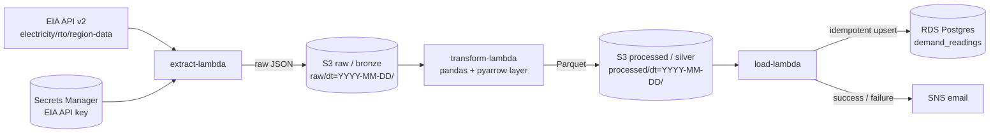

# EIA Electricity Demand ETL Pipeline

A serverless batch ETL pipeline on AWS that pulls hourly U.S. electricity **demand** and **day-ahead demand forecasts** from the [EIA Open Data API](https://www.eia.gov/opendata/), reshapes them into an analysis-ready table with a forecast-error column, and loads them into Postgres. All infrastructure is defined in **Terraform**.

> **Status: work in progress.** The extract → transform → load path works end to end when each step is invoked manually. Orchestration (Airflow), automated tests and a dashboard are the next milestones. See [Status and roadmap](#status-and-roadmap) for details.

## Why this dataset

Electricity demand is a live story: data-center and AI power use is changing load forecasts across the grid. The hourly API publishes both **actual demand (`D`)** and the **day-ahead forecast (`DF`)**, so the pipeline can compute how far off the forecast was for every hour (`forecast_error_mwh`). That gives the table a built-in analytical question to answer.

## Architecture



| Stage | Lambda | What it does |
|---|---|---|
| **Extract** | `extract-lambda` | Calls EIA API v2 for a bounded window (3 days back to 2 days ahead), paginates 500 rows at a time with a safety cap, retries with exponential backoff and explicit timeouts, and writes the **untouched** JSON response to the raw bucket, partitioned by date. The API key is read from Secrets Manager and cached per warm invocation. |
| **Transform** | `transform-lambda` | Reads the latest raw file, coerces types, drops rows with missing values, pivots `D` / `DF` into `demand_actual_mwh` and `demand_forecast_mwh` per `(period, respondent)`, computes `forecast_error_mwh`, and writes **Parquet** to the processed bucket. |
| **Load** | `load-lambda` | Reads the latest Parquet file and **upserts** it into Postgres with `ON CONFLICT (period, respondent) DO UPDATE`, so re-running the same file never creates duplicates. Publishes an SNS message with the row count on success, or the error on failure. |

## Design decisions

- **Raw-then-curated storage (bronze/silver).** Raw API responses are kept exactly as received, so the transform can be fixed and re-run without calling the API again. Raw objects expire after 90 days through an S3 lifecycle rule.
- **Idempotent load.** The upsert key `(period, respondent)` means retries and reruns are safe. This matters because EIA revises recent hours and forecast rows later gain actuals.
- **Secrets stay out of Terraform state.** Terraform creates only the Secrets Manager *container*. The key's value is set once with the AWS CLI, so it never appears in state or in the repo. Pipeline code never logs it.
- **Least-privilege IAM, one role per Lambda.** The Terraform Lambda module is told not to create its own role (`create_role = false`) and is handed an explicitly scoped one instead, so the policies you write are the ones actually attached.
- **No database passwords in the Lambda.** The load Lambda authenticates to RDS with short-lived **IAM database tokens** over SSL (`rds.force_ssl = 1`). The master password is generated and stored by AWS (`manage_master_user_password`).
- **Terraform modules per concern:** `storage`, `compute`, `iam`, `secrets`, `database`, `messaging`.
- **Failures notify, not just successes.** The load step emails on both outcomes, so a silent failure can't pass as a quiet day.

## Repository layout

```
.
├── pipeline/
│   ├── extract/extract_lambda.py
│   ├── transform/transform_lambda.py
│   └── load/load_lambda.py
├── infra/
│   ├── main.tf                  # wires the modules together
│   ├── variables.tf             # pandas layer ARN, notification email
│   ├── terraform.tfvars.example
│   └── modules/
│       ├── storage/             # raw + processed S3 buckets, lifecycle rule
│       ├── compute/             # the three Lambda functions
│       ├── iam/                 # one role + scoped policy per Lambda
│       ├── secrets/             # Secrets Manager container for the API key
│       ├── database/            # RDS Postgres 16, parameter group, security group
│       └── messaging/           # SNS topic + email subscription
├── dags/
│   └── eia_pipeline_dag.py      # Airflow DAG: extract → validate → transform → validate → load
├── docker-compose.yaml          # self-hosted Airflow (Docker Compose, CeleryExecutor)
├── Dockerfile                   # extends the Airflow image with apache-airflow-providers-amazon
└── requirements.txt             # Airflow image dependency: apache-airflow-providers-amazon
```

## Getting started

**Prerequisites:** an AWS account and credentials, Terraform, Python 3.12, `psql`, and a free [EIA API key](https://www.eia.gov/opendata/register.php). Everything deploys to `us-east-1` by default.

> Running this creates billable resources (an RDS `db.t3.micro` instance and its storage). Run `terraform destroy` when you're not using it.

**1. Vendor the Postgres driver for the load Lambda** (the pandas/pyarrow layer is supplied by AWS; `pg8000` is not):

```bash
pip install -r pipeline/load/requirements.txt -t pipeline/load
```

**2. Deploy the infrastructure**

```bash
cd infra
cp terraform.tfvars.example terraform.tfvars   # set notification_email
terraform init
terraform apply
```

Confirm the SNS subscription email that AWS sends you, or notifications won't arrive.

**3. Store the EIA API key** (once, outside Terraform):

```bash
aws secretsmanager put-secret-value \
  --region us-east-1 \
  --secret-id eia-etl/eia-api-key \
  --secret-string "YOUR_EIA_API_KEY"
```

**4. Create the table and the IAM-authenticated database user** (one-time, connected as the master user whose password AWS stored in Secrets Manager):

```sql
CREATE TABLE demand_readings (
    period               TIMESTAMPTZ NOT NULL,
    respondent           TEXT        NOT NULL,
    respondent_name      TEXT,
    demand_actual_mwh    DOUBLE PRECISION,
    demand_forecast_mwh  DOUBLE PRECISION,
    forecast_error_mwh   DOUBLE PRECISION,
    PRIMARY KEY (period, respondent)
);

CREATE USER load_lambda_user;
GRANT rds_iam TO load_lambda_user;
GRANT SELECT, INSERT, UPDATE ON demand_readings TO load_lambda_user;
```

**5. Run the pipeline** (always pass `--region`, or the CLI may hit a different region than Terraform deployed to):

```bash
aws lambda invoke --region us-east-1 --function-name extract-lambda   /dev/stdout
aws lambda invoke --region us-east-1 --function-name transform-lambda /dev/stdout
aws lambda invoke --region us-east-1 --function-name load-lambda      /dev/stdout
```

By default each step picks up the most recent file from the previous stage. You can also pass `{"s3_key": "..."}` as the event to process a specific file.

**6. (Optional) Orchestrate with Airflow instead of invoking Lambdas by hand:**

```bash
echo "AIRFLOW_UID=$(id -u)" > .env
echo "FERNET_KEY=$(python3 -c 'from cryptography.fernet import Fernet; print(Fernet.generate_key().decode())')" >> .env
docker compose up airflow-init
docker compose up -d
```

Open the UI at `localhost:8080`, unpause `eia_pipeline_dag`, and trigger a run. The DAG chains extract → validate → transform → validate → load, retries each Lambda invoke twice with backoff, and emails on any task failure via the SNS topic set up in step 2.

**Configuration.** The extract Lambda reads `EIA_RESPONDENTS` (default `NY`) and `EIA_TYPES` (default `D,DF`). To add regions, copy the respondent codes from the [EIA API browser](https://www.eia.gov/opendata/browser/electricity/rto/region-data).

## Status and roadmap

| Area | Status |
|---|---|
| Terraform: storage, IAM, secrets, compute, database, messaging modules | ✅ Built |
| Extract Lambda (pagination, retries, Secrets Manager) | ✅ Built |
| Transform Lambda (pivot, forecast error, Parquet) | ✅ Built |
| Load Lambda (idempotent upsert, IAM DB auth) | ✅ Built |
| SNS success/failure notifications | ✅ Built |
| Airflow orchestration (DAG with retries and failure callbacks) | ✅ Built |
| Unit tests on real edge-case API data; integration tests | 🔜 Next |
| Dashboard (Streamlit) on top of Postgres | 🔜 Planned |
| Terraform remote state (S3 backend + DynamoDB lock) | 🔜 Planned |
| Architecture write-up / blog post on the tradeoffs | 🔜 Planned |

### Known limitations

- **The database is publicly reachable.** To keep the Lambdas outside a VPC (and avoid NAT gateway cost during development), the RDS instance accepts connections on port 5432 from anywhere. Access is gated by IAM authentication and enforced SSL, but the proper fix is to move the Lambdas into the VPC (or use RDS Proxy) and close the security group. This is the first thing I'd change before treating the project as production-like.
- **State is local for now.** `backend.tf` is intentionally empty until the S3 + DynamoDB remote-state backend is set up.
- **Row-by-row upserts.** Fine at this volume (a few hundred rows per run). A bulk `INSERT ... ON CONFLICT` or `COPY` into a staging table would be the next step for larger loads.
- **"Latest file" selection.** Transform and load pick the most recently written object when no key is passed. Airflow will pass explicit keys between tasks.
- **The table DDL lives in this README,** not in a migration. A `sql/schema.sql` is on the to-do list.

## Tech stack

Python 3.12 · AWS Lambda · S3 · RDS PostgreSQL 16 · Secrets Manager · SNS · IAM · Terraform · pandas / pyarrow · pg8000 · Apache Airflow (Docker Compose, CeleryExecutor)

## Data source

[U.S. Energy Information Administration (EIA) Open Data API v2](https://www.eia.gov/opendata/), route `electricity/rto/region-data`, with data types `D` (demand) and `DF` (day-ahead demand forecast).
